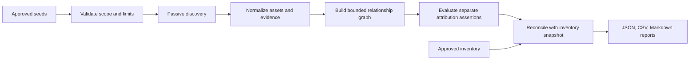

# Múcaro | Averiguao — Stage 1 architecture

> **Status:** design document. The implemented subset (domain, IP and prefix seeds; CT, DNS-over-HTTPS, RDAP and InternetDB) and every rule it follows are in [RULES.md](RULES.md), which also lists where the implementation differs from this design. ASN seeds, BGP and passive DNS are not built yet.

## Purpose and boundary

The Averiguao proof of concept identifies public infrastructure candidates that are missing from an approved inventory. It uses approved organizational seeds and passive observations, then produces evidence that an analyst can inspect. A discovery relationship is not an ownership claim.

Stage 1 covers architecture for a Python analysis pipeline. The planned inputs are approved domains, public IP addresses, prefixes, ASNs, and an authoritative inventory snapshot. The planned sources are passive DNS, RDAP, BGP observations, and Certificate Transparency (CT). The planned outputs are JSON, CSV, and Markdown reports. Active scanning, automatic inventory updates, and physical office detection are outside this milestone.

## Pipeline

Each stage retains identifiers from the preceding stage. A report finding must contain at least one path from an approved seed to the candidate, with evidence for every edge of that path. A source observation may enrich a candidate without authorizing further graph expansion.

## Core records

| Record | Required fields | Purpose |
| --- | --- | --- |
| `Seed` | ID, type, normalized value, approving authority or scope reference, scope version | Defines where discovery may begin. |
| `Asset` | Stable ID, type, normalized value | Represents a domain, hostname, IP, prefix, or ASN independently of claims about it. |
| `Evidence` | ID, source, query or retrieval reference, raw-record hash or stored reference, `observed_at`, source validity interval if reported, source record ID if available | Preserves provenance and time. Unknown source validity remains explicitly unknown. |
| `Relationship` | Subject asset, predicate, object asset, evidence IDs, seed lineage, discovery depth | Records observations such as `hostname_resolves_to_ip`, `prefix_announced_by_asn`, or `certificate_mentions_hostname`. |
| `Assertion` | Asset, organization, dimension, value, supporting and contradicting evidence IDs, assessment, rationale | Separately assesses ownership, operational control, hosting, and service association. |
| `InventoryMatch` | Candidate asset, inventory snapshot ID, matched inventory record ID or null, match rule, status | Makes reconciliation reproducible. |
| `Finding` | Candidate asset, reconciliation bucket, relevant assertion IDs, evidence path IDs, conflicts, review state | Feeds all report formats. |

The four attribution dimensions are independent:

- **Ownership:** legal or registered ownership of an address, prefix, ASN, or domain.
- **Operational control:** who configures or administers the asset or service.
- **Hosting:** which provider supplies the underlying infrastructure.
- **Service association:** whether the asset supports an organizational service.

Each assertion uses `supported`, `contradicted`, or `unresolved`, with a rationale and evidence IDs. A cloud provider's RDAP registration can support a hosting or address ownership assertion about that provider; it cannot by itself establish organizational ownership or operational control. An organizational hostname resolving to an IP supports service association at the observation time, but does not by itself establish control of that IP. Conflicting evidence remains visible; the pipeline does not silently choose a winner.

## Discovery policy

The run configuration records its exact scope and limits. Proposed Stage 1 defaults are:

| Starting seed | Direct discovery allowed | Secondary expansion allowed |
| --- | --- | --- |
| Domain | DNS records for the exact domain and in-scope names observed in CT; CT names must remain under the approved domain boundary | Resolve those in-scope names to IPs. Enrich resulting IPs with RDAP and BGP, but do not enumerate their neighbors. |
| IP | RDAP, BGP origin/prefix context, and passive DNS names directly observed for that IP | Keep names as candidates only when they match an approved domain or have independent organizational evidence. Do not follow unrelated names to more IPs. |
| Prefix | Addresses or DNS names observed within the prefix; RDAP and BGP context | Do not expand to adjacent or covering prefixes unless separately approved. |
| ASN | Prefixes observed as originated by that ASN, then passive evidence for those prefixes | Do not traverse peer ASNs, upstreams, downstreams, or historical origin ASNs as new seeds. |

The default maximum discovery depth is two relationship hops from a seed. Enrichment edges do not grant permission for another hop. CT certificate co-occurrence, shared IP hosting, RDAP registrant similarity, and BGP adjacency can provide context but never become unrestricted expansion rules. Per-run limits on names, addresses, prefixes, queries, and elapsed time are required configuration fields; exceeding one produces a partial-result flag and a recorded truncation reason. Every connector obeys its source's allowed access method and rate limits.

## Time and historical evidence

Every evidence record stores the time Averiguao retrieved or observed it in UTC (`observed_at`). It also stores the validity period reported by the source, when one exists, without treating retrieval time as the start of that period. A DNS observation may have a collection time and TTL; a certificate has validity dates; a BGP observation may have an announcement time or interval. These fields have different meanings and remain distinct.

An assertion is evaluated for the inventory snapshot's as-of time. Historical evidence can support a historical relationship, but it cannot silently become a current assertion. The report shows stale evidence, changed relationships, and contradictory observations. Repeated runs retain prior evidence IDs so changes can be compared without overwriting history.

## Inventory reconciliation

The baseline is a versioned, read-only inventory snapshot with an as-of timestamp. Normalize domain case and trailing dots, canonicalize IPs and prefixes, and preserve inventory IDs. Exact asset matches are automatic. Prefix containment and domain hierarchy are candidate matches requiring an explicit rule and review; an ASN match alone does not prove that every announced IP is already inventoried.

The engine records two independent outcomes for each candidate: inventory match (`matched`, `unmatched`, or `indeterminate`) and organizational role (`first-party`, `third-party`, or `unresolved`). The report presents these as four working queues:

| Queue | Rule | Analyst action |
| --- | --- | --- |
| Known | Matched to an inventory record | Confirm the recorded relationship and note conflicts. |
| Newly discovered | Unmatched and supported as owned or operated by the organization | Review for inventory addition. |
| Unexplained | Unmatched with an organizational link but unresolved ownership and control | Investigate before classification. |
| Third-party | Unmatched and supported as externally owned or operated, while associated with an organizational service | Review vendor or service dependency; do not add as organizational property. |

An indeterminate inventory match stays in the unexplained queue with an explicit `inventory_match_indeterminate` flag. The queue is a triage decision, not a claim of physical location or office presence. No record is automatically written into the authoritative inventory.

## Traceable finding example

For an approved `example.com` domain seed, a CT observation may identify `portal.example.com`; a DNS observation may link it to `198.51.100.42`; RDAP may identify a hosting provider for that IP. The finding stores the path `seed → hostname → IP`, the CT and DNS evidence IDs supporting the two edges, and the RDAP evidence ID supporting the provider assertion. The organizational service association may be supported while organizational IP ownership and operational control remain unresolved. If the IP is absent from inventory, the resulting queue is unexplained or third-party according to the evidence for external operation. The IP's neighboring addresses and unrelated domains on the same host are not discovered from this path.

## Report contract

- **JSON:** Full normalized records, assertions, evidence paths, source timestamps, inventory snapshot metadata, scope configuration, run limits, and truncation warnings. This is the reproducible source of truth.
- **CSV:** One row per candidate with asset ID and value, queue, inventory match, four attribution assessments, strongest seed path, evidence IDs, observation range, and review flags. Nested evidence remains in JSON.
- **Markdown:** Analyst summary, counts by queue, highest-value unmatched candidates, conflicts, stale evidence, and concise evidence paths with source references.

Rank candidates for analyst review by relevance and evidence quality, not by raw discovery volume. The report should distinguish direct observations from inferences and show why each candidate was retained. It should disclose source failures and truncated searches so absence of a finding is not mistaken for absence of infrastructure.

## Stage 1 acceptance criteria

1. Every reported candidate has an approved seed ID and an inspectable evidence-backed path from that seed.
2. Ownership, operational control, hosting, and service association can differ for the same asset without being collapsed into one score.
3. An approved inventory snapshot is required for a completed run; all candidates receive a reconciliation outcome and a documented match rule.
4. Discovery stops at configured boundaries and caps; truncated runs identify what was omitted.
5. Observation time and source validity are preserved separately, including when validity is unknown or evidence conflicts.
6. JSON, CSV, and Markdown expose the same candidate IDs and classifications, with JSON retaining the full provenance.
7. A review set includes at least one known asset, one newly discovered first-party candidate, one unexplained candidate, and one third-party service dependency. Reviewers evaluate false positives and the number of relevant, previously unaccounted-for candidates, rather than total IP count.
